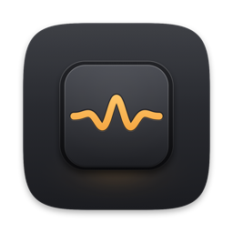
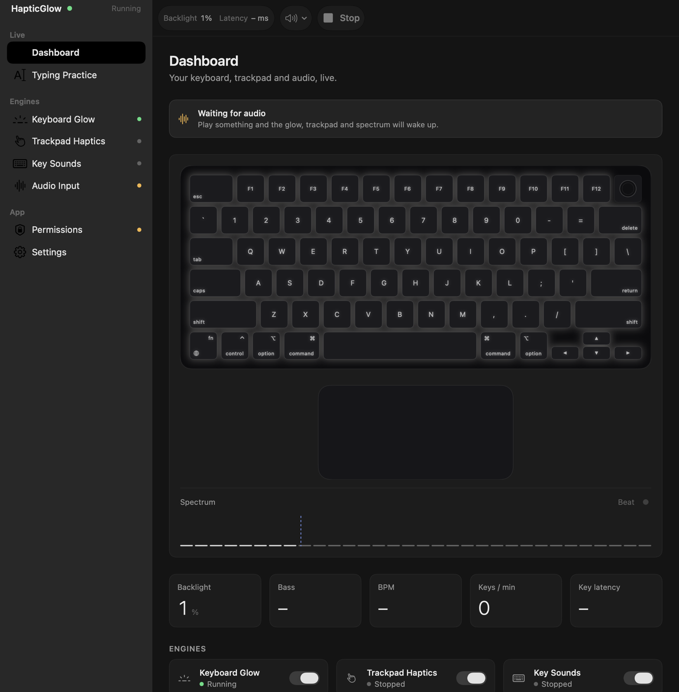
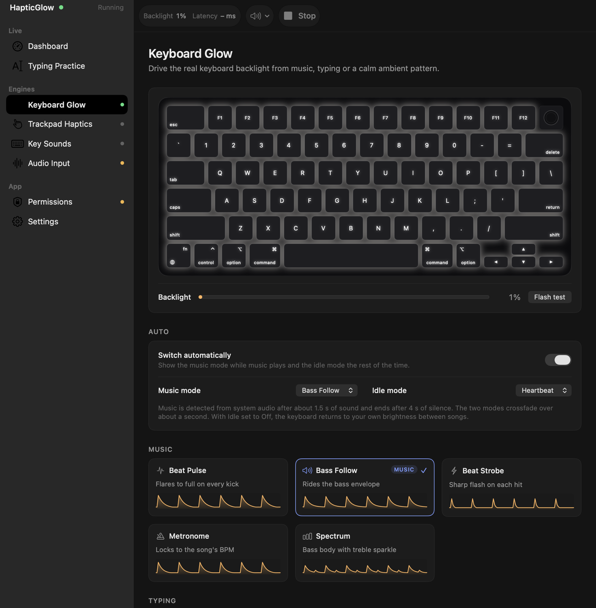
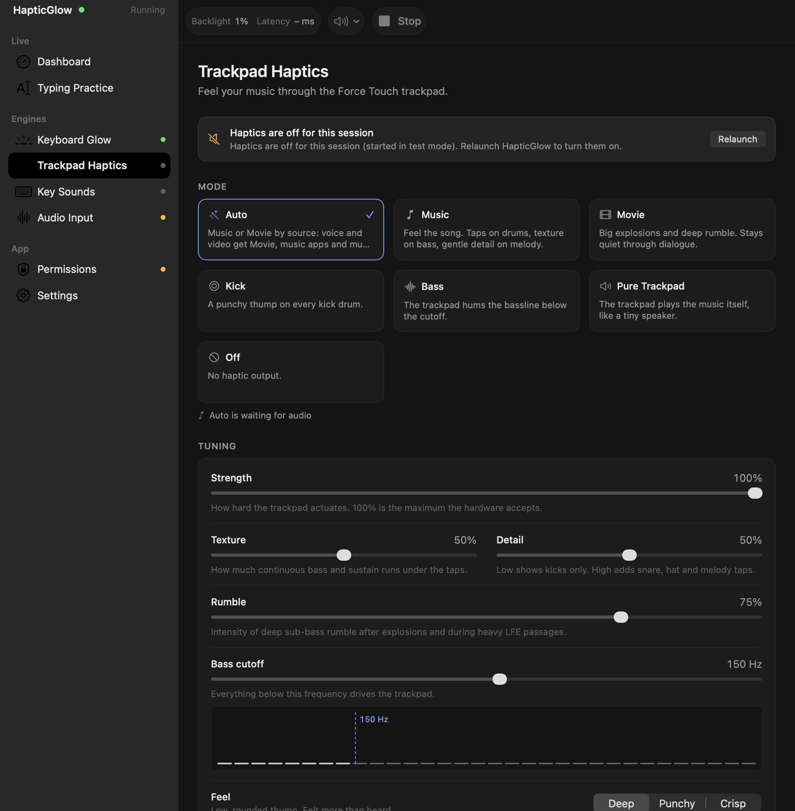

<p align="center">
  
</p>

<h1 align="center">HapticGlow</h1>

<p align="center">
  Keyboard backlight, Force Touch trackpad haptics and mechanical key sounds for macOS.
</p>

<p align="center">
  <a href="https://github.com/VA24d/HapticGlow/releases/latest/download/HapticGlow.dmg">Download</a> &middot;
  <a href="docs/README.md">Docs</a> &middot;
  <a href="https://github.com/VA24d/HapticGlow/releases">Releases</a>
</p>

<p align="center">
  <a href="LICENSE.md"></a>
  
  
  <a href="https://github.com/VA24d/HapticGlow/actions/workflows/ci.yml"></a>
</p>

<p align="center">
  
</p>

HapticGlow is a native Swift and SwiftUI app that reads macOS system audio in memory to pulse the built-in keyboard backlight and Force Touch trackpad actuator in time with playback, and plays recorded switch sounds on key presses. It captures audio via Core Audio process taps (with ScreenCaptureKit as a fallback), without a virtual audio device or microphone.

## Requirements

- macOS 26 or later on Apple Silicon (`arm64`)
- MacBook with a backlit keyboard and Force Touch trackpad (or an external Magic Trackpad); each engine runs independently if hardware is absent
- Optional: Logitech MX Keys keyboard over Bluetooth

## Features

- 15 keyboard glow modes across music (Beat Pulse, Bass Follow, Beat Strobe, Metronome, Spectrum), typing (Key Pulse, Typing Heat) and ambient patterns (Steady, Breathe, Heartbeat with optional CPU load tracking, Candle, Aurora, Lightning, Sleep, Off), with auto-switching between a music mode and an idle mode
- Trackpad haptics with Music, Movie, Kick, Bass and Pure Trackpad modes, plus an Auto mode that switches between Music and Movie from the playing app, browser tab URL or audio classifier
- A safety governor in the trackpad driver that clamps drive levels, caps actuation rate and duty cycle, and forces rest windows
- 12 key switch sound packs from kbsim (Holy Panda, Topre, Box Navy, SKCM Blue Alps, IBM Buckling Spring, NovelKeys Cream, Gateron Ink Black, Cherry MX Black, Gateron Ink Red, Tealios, Cherry MX Brown, Alpaca) with stereo or spatial placement by key position and speaker tuning
- Logitech MX Keys backlight mirroring over HID++ Bluetooth LE, timed early to match link delay
- Typing practice with Words, Timed, Quotes, Code and Weak keys drills, session history and per-key heatmaps
- Menu bar panel to start and stop, switch glow modes, adjust brightness and toggle each engine

<p align="center">
  
  
</p>

## Install

Download [HapticGlow.dmg](https://github.com/VA24d/HapticGlow/releases/latest/download/HapticGlow.dmg) from the latest release, open the disk image, and drag `HapticGlow.app` to `Applications`. Older versions and release notes are on [Releases](https://github.com/VA24d/HapticGlow/releases). Each release also includes a `.sha256` checksum file.

Releases are currently ad-hoc signed and not notarized. On first launch, right-click `HapticGlow.app` in `Applications`, choose Open, and confirm Open in the dialog. If Gatekeeper still blocks it, clear the quarantine attribute once:

```sh
xattr -dr com.apple.quarantine /Applications/HapticGlow.app
```

Because an ad-hoc signature changes with every build, macOS prompts again for System Audio Recording and Input Monitoring after updates.

## Permissions

| Permission | Purpose |
|---|---|
| System Audio Recording | Default capture path (`System Audio Tap`) to read system output in memory for glow and haptics. |
| Screen & System Audio Recording | Fallback path when audio source is set to `Screen Capture Audio`; the screen is not read or stored. |
| Input Monitoring | Global key events for key sounds, typing glow, typing practice and opening Logitech MX Keys HID reports. |

The Permissions page tracks those three grants and opens the matching System Settings panes. If Auto trackpad haptics runs while a Safari or Chromium browser is playing, macOS prompts once for Automation so HapticGlow can check the active tab URL; if declined, Auto falls back to local audio analysis. See [docs/troubleshooting.md](docs/troubleshooting.md) if macOS ignores a grant after a rebuild.

## Privacy

HapticGlow makes no network connections and collects no telemetry or crash reports. Audio buffers and key events stay in memory, and diagnostic logs stay locally at `~/Library/Logs/HapticGlow/hapticglow.log`. See [PRIVACY.md](PRIVACY.md).

## Build from source

HapticGlow compiles with `swiftc` using the Swift 6.2 Command Line Tools (`arm64-apple-macos26.0`), with no Xcode project or SwiftPM manifest.

```sh
git clone https://github.com/VA24d/HapticGlow.git
cd HapticGlow
./build.sh              # release build -> build/HapticGlow.app
./build.sh install      # release build and copy to /Applications/HapticGlow.app
./build.sh typecheck    # type-check only
```

See [docs/building.md](docs/building.md) for local code-signing setup, snapshot rendering and the Command Line Tools `SwiftBridging` VFS overlay workaround.

## Known limitations

- Releases are ad-hoc signed and not notarized yet.
- Built-in keyboard backlight control loads `CoreBrightness.framework` (`KeyboardBrightnessClient`) via `dlopen`, and trackpad haptics load `MultitouchSupport.framework`. Both are private macOS frameworks and may break in future macOS updates.
- MacBook keyboards share one backlight channel across all keys; per-key animation appears only in the on-screen visualizer.
- Logitech MX Keys support has been tested on one keyboard over Bluetooth LE.
- Trackpad haptics operate within hard safety limits in the motor driver (clamped drive levels, actuation rate, 60% duty cycle, rest windows after continuous high-energy runs, and automatic halt on repeated driver errors).

## Documentation

- [Documentation index](docs/README.md)
- [User guide](docs/user-guide.md)
- [How it works](docs/how-it-works.md)
- [Troubleshooting](docs/troubleshooting.md)
- [Building](docs/building.md)

## Contributing

Bug reports and pull requests are welcome. See [CONTRIBUTING.md](CONTRIBUTING.md) before opening a PR.

## Security

Report security issues privately through GitHub Security Advisories as described in [SECURITY.md](SECURITY.md).

## Credits

HapticGlow adapts code from MagicKey (XiaoSong1223), nospeaker (Cody Collier / os6) and Thock (kamillobinski), and takes design ideas from Clacky (jasonzh0). The bundled key sound packs come from [kbsim](https://github.com/tplai/kbsim) by Thomas Lai under the MIT License. See [CREDITS.md](CREDITS.md) and [Sounds/CREDITS.md](Sounds/CREDITS.md).

## License

HapticGlow is licensed under the GNU General Public License, version 3 only ([LICENSE.md](LICENSE.md)), with an attribution term under section 7(b) in [NOTICE.md](NOTICE.md): redistributions of HapticGlow or derivative works must keep **"HapticGlow by Vijay A (https://github.com/VA24d/HapticGlow)"** visible in the README, in a `NOTICE` file, and in the About window if present.

The sound files in `Sounds/` remain under the MIT License ([Sounds/LICENSE-kbsim.txt](Sounds/LICENSE-kbsim.txt)). Usage terms are in [TERMS.md](TERMS.md).
