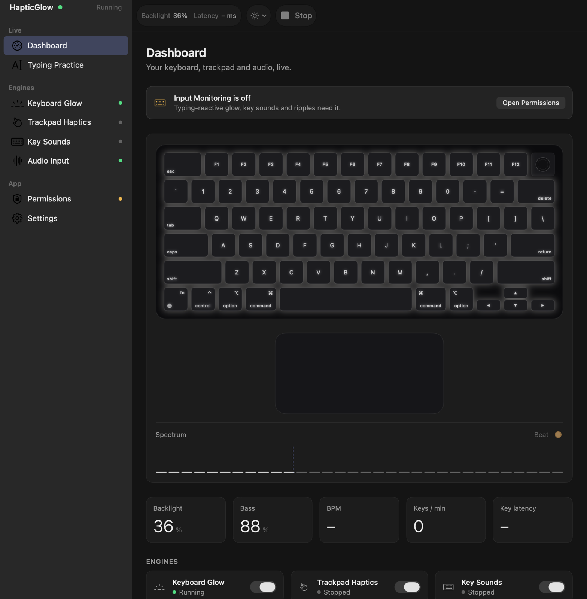
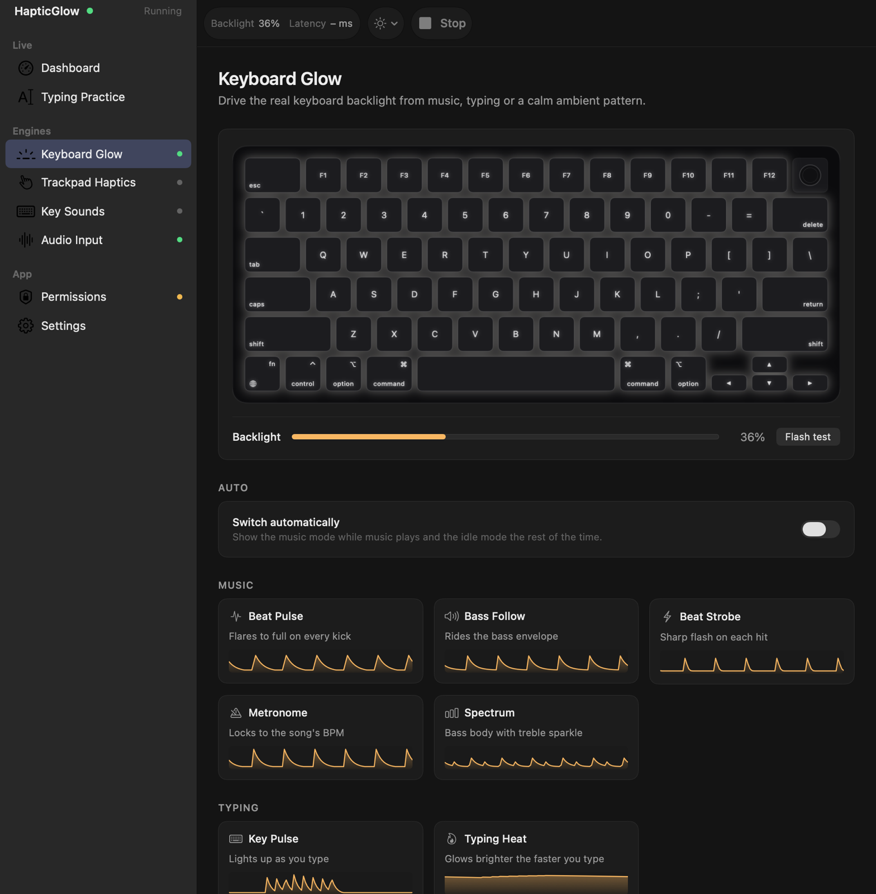
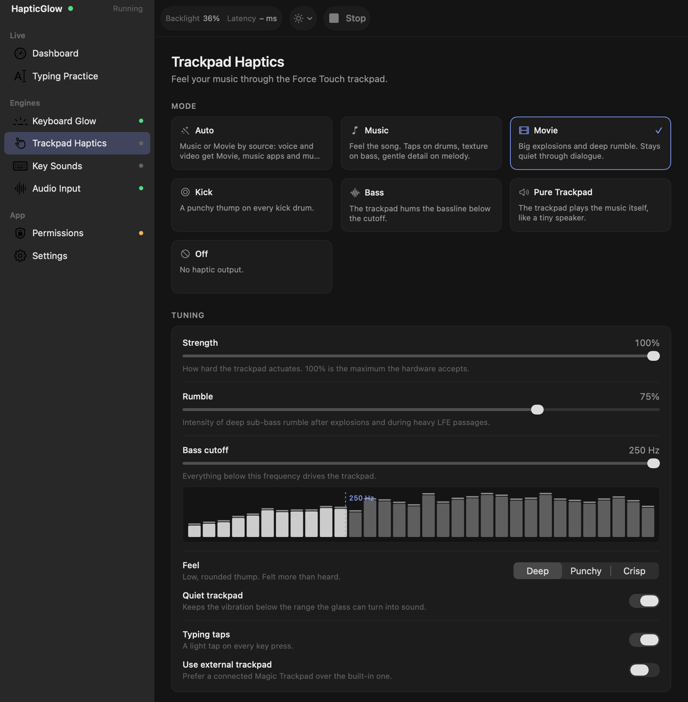
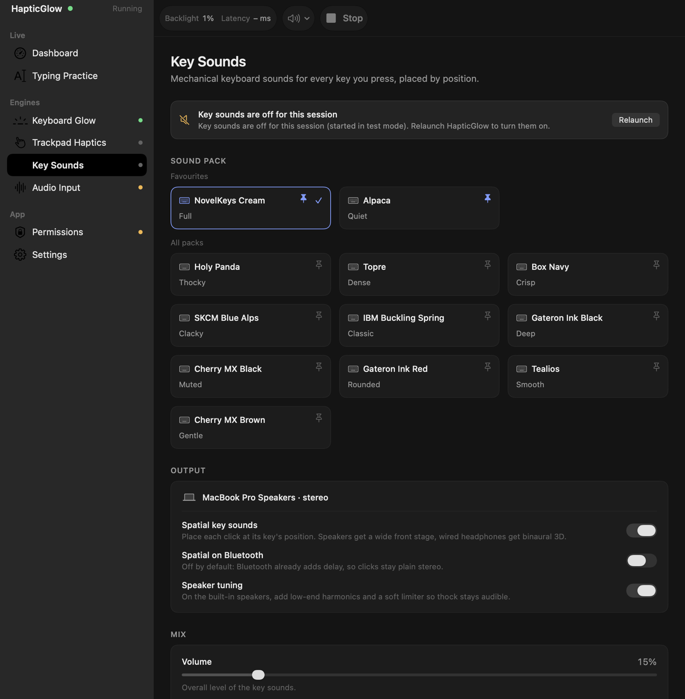
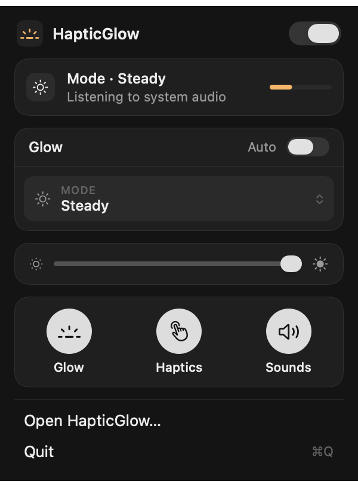

# User guide

The sidebar lists eight pages. `Cmd+1` to `Cmd+8` jump to Dashboard, Typing Practice, Keyboard Glow, Trackpad Haptics, Key Sounds, Audio Input, Permissions and Settings; `Cmd+/` shows every shortcut.

Press **Start** on the Dashboard (or `Cmd+Return`) to switch everything on. Press it again to stop. On stop and on quit, the app puts the keyboard backlight back the way macOS had it.

## Dashboard

A live overview. It shows the audio spectrum, the beat, the current backlight level, bass level, tempo (BPM), keys per minute and key latency. Cards for Keyboard Glow, Trackpad Haptics and Key Sounds show what each part is doing.

Banners appear here when something needs attention: paused, no audio capture, waiting for audio, or Input Monitoring off.

## Now playing

While Apple Music or Spotify plays a song, its title and artist appear on the Dashboard and in the menu bar panel. They disappear when the music pauses or stops. HapticGlow reads this from the notifications those apps already send, so it needs no permission. If one of them is already open when HapticGlow starts, macOS may ask once whether HapticGlow can ask it what is playing. Saying no is fine: the song shows up as soon as the next track starts.

**Genre presets.** If the song's genre is known, HapticGlow adjusts the haptics and glow to suit it. Hip-hop, rap, trap and electronic get a stronger kick and fewer small taps. Rock and metal get more snare and hi-hat detail. Soundtrack, classical and ambient get smoother, longer swells. A podcast or audiobook switches Auto to the Movie feel. Any other genre leaves your settings alone. Spotify does not report a genre, so only Apple Music songs get a preset. Turn presets off in Settings under Now playing.

**Remember for this song.** Change the haptic or glow settings while a song plays and a *Remember for this song* button appears. Press it and those changes are applied each time the song comes back. When the song ends or changes, your usual settings return. Saved songs win over genre presets. A setting you change without pressing the button simply stays changed, as it always did. *Forget* removes a song's saved tuning, and *Forget All* in Settings clears them all. Sync is not part of this, because it belongs to your output device.

## Keyboard Glow

Choose a mode from the grid. The modes come in three groups.

- **Music.** Beat Pulse flares to the ceiling on each kick and fades out. Bass Follow tracks the bass level continuously. Beat Strobe gives a short sharp flash per kick. Metronome pulses on predicted beats at the detected tempo. Spectrum mixes bass body with treble sparkle.
- **Typing.** Key Pulse flares on each key press. Typing Heat builds with your typing speed and cools when you stop.
- **Ambient.** Steady holds one level. Breathe, Heartbeat, Candle, Aurora and Lightning are patterns; Heartbeat can follow CPU load, resting when the Mac is idle and racing under load. Sleep breathes slower and slower and fades to off over the fade-out time. Off turns the backlight output off.

Settings on the page:

- **Switch automatically.** Shows your music mode while audio plays and an idle mode (Breathe by default) the rest of the time, crossfaded.
- **Peak brightness, Floor.** The brightest and darkest level the glow may use.
- **Speed.** Time scale for ambient modes, decay length for reactive ones.
- **Sensitivity.** How strongly music modes react.
- **Steady level, Fade-out time.** Only used by Steady and Sleep.
- **Key flash.** Adds a quick flash on each key press, over any mode.
- **Keep keyboard lit.** macOS dims the backlight five seconds after you stop typing. While HapticGlow runs it suspends that, so the music modes can reach full brightness. Turn it off if you prefer the system behaviour.
- **Logitech keyboard.** Mirrors the glow on a connected MX Keys. The page shows the link status.

## Trackpad Haptics

The trackpad motor plays the music. Pick a mode:

- **Auto.** Chooses Music or Movie for you from the app that is playing: voice and video get Movie, music apps and music sites get Music. Browsers are told apart by the playing tab's address, which macOS asks you to allow once; if you decline, or the app is unknown, a quick speech-versus-music check decides. The page shows what Auto picked and why.
- **Music.** Taps for kick, snare and hats, a bass texture underneath and a lighter vibration for melody. *Texture* sets the amount of bass texture; *Detail* sets how many small taps play beside the kicks.
- **Movie.** Impacts and a sub-bass rumble, like a cinema subwoofer. Speech and quiet underscore stay silent. *Rumble* sets the intensity of the sustained part.
- **Kick.** A pitch-dropping thump on each low-band onset. *Punch* sets the decay length and *Pitch* the start pitch.
- **Bass.** The low band streamed to the motor, folded up into the range the motor can reproduce.
- **Pure Trackpad.** The motor plays the two strongest spectral peaks of the music.
- **Off.**

Common settings: *Strength*, *Bass cutoff* (the crossover between bass and the rest), and *Feel* (Deep, Punchy or Crisp voice for kicks and taps).

- **Quiet trackpad** keeps vibration below the range the glass turns into audible sound. Leave it on unless you want the most intense feel.
- **Typing taps** adds a light tap on each key press.
- **Use external trackpad** prefers a connected Magic Trackpad over the built-in one.

The page ends with the Haptics Lab, a collapsed section with manual waveform controls and a guided feel test. Nothing plays there until you press Play.

## Key Sounds

Twelve packs of recorded mechanical switches: Holy Panda, Topre, Box Navy, SKCM Blue Alps, IBM Buckling Spring, NovelKeys Cream, Gateron Ink Black, Cherry MX Black, Gateron Ink Red, Tealios, Cherry MX Brown and Alpaca. Click a pack to select it, or click its pin button to pin it under Favourites. Space, Enter, Backspace and Escape have their own samples.

- **Volume.** Loudness is balanced across packs, so switching packs does not jump in level.
- **Spatial key sounds.** Places each click at its key's position (wide front stage on speakers, binaural 3D on wired headphones).
- **Spatial on Bluetooth.** Off by default on Bluetooth headphones, where the added delay leaves plain stereo cleaner.
- **Spatial spread.** How wide the stereo placement is.
- **Speaker tuning.** On the built-in speakers, adds low-end harmonics and a soft limiter so the low thock stays audible.
- **Pitch variation.** Small random pitch and volume changes, so fast typing does not sound like a machine gun.
- **Release sounds.** Plays the key-up sound too.
- **Modifier sounds.** Lets Shift, Control, Option and Command make sounds.

## Typing Practice

A typing test on your real keyboard. Every key uses your sound pack and lights the backlight. Pick a test mode (words, timed, quotes, code lines or weak-key drills), type, and read your WPM, accuracy, raw speed, consistency and time. The page keeps history, personal bests, per-key stats and a heatmap, and weak-key drills focus on your slowest and most-missed keys.

## Audio Input

Shows what HapticGlow hears and what it does with it.

- **Audio source.** *System Audio Tap* is the default and has the lowest latency. *Screen Capture Audio* is a fallback that needs Screen Recording permission instead.
- **Status.** Capture callbacks, sample rate and analyzer state, with live level and onset meters.
- **Sync delay.** Your output device plays sound after the Mac captures it, and Bluetooth adds roughly 150 to 250 ms. The page shows the delay in use and how it was found.
- **Measure with microphone.** In *Adjust*, this button times your speakers for you. Play music or a video through the Mac's speakers or a monitor, keep the room quiet and press it. HapticGlow listens through the built-in microphone for about 6 seconds, compares that with the audio the Mac sent out, and shows a result such as "Measured 112 ms. Reported 25 ms." *Apply* then sets the fine-tune for that output so the delay matches. If the result is unclear (too quiet, too much room noise, or nothing playing) it says why and changes nothing. It cannot work with headphones or Bluetooth, because the microphone cannot hear them. The microphone is used only while you measure; macOS asks for permission the first time, the audio is analysed in memory and never stored or sent, and your default input device is left alone.

## Permissions

Shows the three permissions with their current state, a button to request each one and a button to open the right System Settings pane. Details are in the [README](../README.md#permissions). After granting Input Monitoring, relaunch the app with the button at the bottom of the page.

## Settings

- **Launch at login** and **Show in menu bar**.
- **Appearance.** Follow the system, or force light or dark.
- **Onset sensitivity.** How readily the analyzer calls a kick.
- **Now playing.** Turn genre presets on or off, and forget saved songs.
- **Sync.** *Auto (device latency)* uses the delay your output device reports. *Fine-tune* shifts the glow and haptics by up to 300 ms earlier or later. If the light flashes before you hear the beat, move it later. *Measure with microphone* in the Audio Input page's Adjust panel can find the value for you.
- **Restore keyboard backlight.** Puts brightness and auto-brightness back as macOS had them.
- **Log file** location, and **Welcome tour** replay.

## Menu bar

The menu bar panel has a Running switch, a status line with the current glow mode, the song that is playing, an Auto switch with pickers for the music mode and the idle mode, a brightness slider, buttons for Glow, Haptics and Sounds, Open HapticGlow and Quit.

It can be hidden in Settings.

## Keyboard shortcuts

| Shortcut | Action |
|---|---|
| `Cmd+Return` | Start or stop |
| `Cmd+[` and `Cmd+]` | Previous and next glow mode |
| `Cmd+Option+Up` and `Down` | Raise or lower the brightness ceiling by 0.05 |
| `Cmd+M` | Mute or unmute key sounds |
| `Cmd+Shift+H` | Haptics on or off |
| `Cmd+1` to `Cmd+8` | Dashboard, Typing Practice, Keyboard Glow, Trackpad Haptics, Key Sounds, Audio Input, Permissions, Settings |
| `Cmd+,` | Settings |
| `Cmd+/` | Shortcut cheat sheet |
| `Cmd+Option+M` | Minimize |
